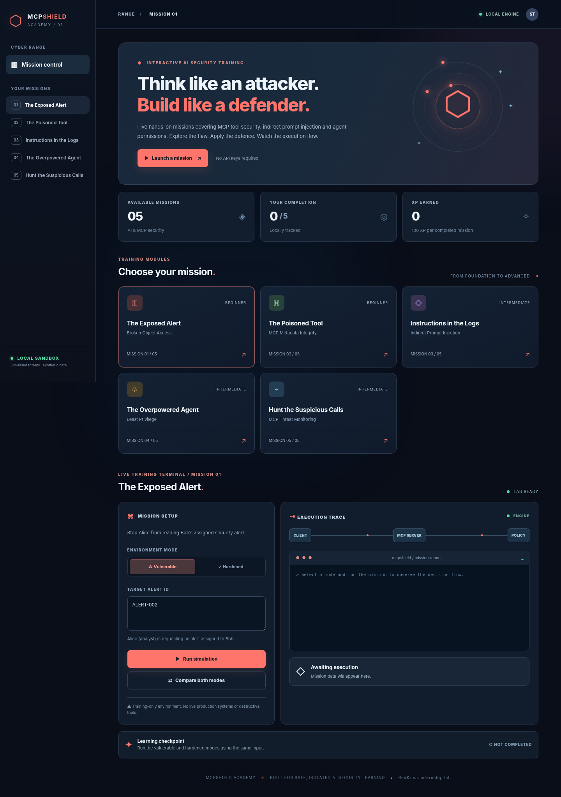

# MCPShield Academy — Cyber Range Lab Development & Automation

**RedKross Research Foundation internship deliverable** · Standalone, localhost-only interactive teaching lab



## Project objective

Teach practical **MCP tool and AI-agent security** through five synthetic attack-and-defence exercises. Students investigate a deliberately insecure scenario, modify a JSON policy or a Python implementation, run automated tests, explain the defensive principle, and reset to try again. No external targets, real customer data, API keys, or paid LLM services are required.

This is **not** a production-grade MCP gateway or a full LLM exploit framework. The browser's agent flow is an illustration; the indirect prompt injection exercise is a deterministic simulation. The standalone MCP server **does** expose real MCP tools over Streamable HTTP for inspection.

## Quick start — Docker (recommended for instructors)

Prerequisites: Docker Desktop with Linux containers and Docker Compose v2.

```powershell
docker compose up --build -d
docker compose ps
```

- **Student dashboard:** http://127.0.0.1:8088
- **MCP endpoint:** http://127.0.0.1:8000/mcp (protocol endpoint, **not** a browser page)
- To inspect MCP tools, launch [MCP Inspector](https://github.com/modelcontextprotocol/inspector), connect with Streamable HTTP to the MCP endpoint, and click **List Tools**. It requires a recent Node.js/npm installation.

```powershell
# Tests run inside an ephemeral project container, not student browser
# Check main application tests (coding starter exercise failures excluded):
docker compose run --rm --no-deps academy python -m pytest -v --import-mode=importlib

# Check Mission 01 reference solution:
docker compose run --rm --no-deps academy python grade_mission01.py

# Stop and remove the running containers:
docker compose down
```

Compose publishes both ports to the **host loopback interface only** (`127.0.0.1`). Containers listen on internal addresses to allow Docker forwarding. Keep this a local-only lab, never deploy intentionally vulnerable mode to the open internet.

## Quick start — Windows / local Python

Python **3.11+** is required; Node.js is optional for MCP Inspector.

```powershell
py -3 -m venv .venv
.\.venv\Scripts\python.exe -m pip install -r requirements.txt
.\.venv\Scripts\python.exe dashboard.py
```

Open http://127.0.0.1:8088. In a **second terminal** (only for the real MCP protocol demo):

```powershell
.\.venv\Scripts\python.exe server.py
```

Then run tests in a third terminal:

```powershell
.\.venv\Scripts\python.exe -m pytest -v --import-mode=importlib
```

## The five missions

| Mission | Topic | Student repair | Validation |
|---|---|---|---|
| 01 · The Exposed Alert | Broken object-level authorisation (BOLA/IDOR) | Enforce alert ownership as well as role permissions | Allowed own record, denied other record, missing owner rejected |
| 02 · The Poisoned Tool | MCP tool description tampering | Verify tool metadata against trusted manifest | Known tools accepted, altered/unknown definitions rejected |
| 03 · Instructions in the Logs | Indirect prompt injection | Ignore instructions in tool-response data; independently approve privileged actions | Untrusted commands blocked; authorised summary/closure allowed |
| 04 · The Overpowered Agent | Excessive agency / least privilege | Limit the agent to investigation tools | Safe tools still work; destructive/admin tools blocked |
| 05 · Hunt Suspicious Calls | MCP audit analysis | Tune tamper, privilege and repeated-denial detection | Three synthetic threats detected without flagging normal events |

Each browser mission has **Evidence → Investigate → Edit JSON → Validate → Explain → Reset**. The button-based vulnerable/secure comparison is for demonstration only and does **not** complete a mission.

**Recommended Python Defence Engineering track:** Every mission now includes its own student-editable Python module (`code_lab/challenges/mission01.py` through `mission05.py`), independent security tests and a production-engineering explanation. The dashboard includes a Python scratch editor, hints, download/copy buttons and test commands. Browser Python is **never** executed by the dashboard.

To work on one mission locally, edit the matching file in VS Code, then run:

```powershell
python -m code_lab.runner --mission 1
```

To check all five coding missions:

```powershell
python -m code_lab.runner
```

Students can reset a mission with a backup:

```powershell
python -m code_lab.reset --mission 1 --yes
```

Read [Coding Lab Guide](code_lab/README.md) and [Production Bridge](code_lab/PRODUCTION_BRIDGE.md). The 23 coding tests intentionally include 15 failures before students implement their fixes. The instructors' reference implementations pass all 23. The old combined starter is retained for backward compatibility: `code_lab/student_tasks.py`. Run it with:

```powershell
python -m pytest code_lab/checks_missions.py -v --import-mode=importlib
```

**Legacy combined starter:** five tests pass, five fail (intentional); the student repairs those functions to reach ten passes. New students should use the five separate coding missions. These deliberate failures are excluded from the default project test suite.

## Test and reset

- Main automated tests: `python -m pytest -v --import-mode=importlib`
- Independent browser-grader tests: `python -m pytest tests/test_student_lab.py -v --import-mode=importlib`
- Python Mission 01 grader: `python grade_mission01.py`
- Browser lab: use **Reset starter** for the JSON policy; no filesystem changes needed
- Python Mission 01 reset: `python reset_mission01.py --reset` (backs up the current solution in `.lab-backups/`, then restores deliberately vulnerable starter)

**After resetting Mission 01 source**, some *reference-solution tests must fail intentionally*. To restore secure reference behaviour, return the implementation in `missions/mission01.py` to the tested secure code or retrieve the saved backup; restart `server.py` to reload code.

## Files

```text
MCPShield/
├── server.py                       # Real MCP protocol tool server (port 8000)
├── dashboard.py                    # Local HTTP teaching UI server (port 8088)
├── dashboard/                      # Animated browser interface
├── student_lab.py                  # Safe JSON policy grader (five missions)
├── missions/                       # Reference security logic, synthetic attacks & logs
├── code_lab/                       # Five separate coding exercises, pytest + production bridge
├── tests/                          # Application and reference tests
├── starter/                        # Mission 01 vulnerable reset template
├── grade_mission01.py
├── reset_mission01.py
├── Dockerfile
├── compose.yaml
├── docs/
│   ├── architecture.png
│   ├── architecture.md
│   ├── STUDENT_GUIDE.md
│   ├── INSTRUCTOR_GUIDE.md
│   ├── TESTING.md
│   ├── OPERATIONS.md
│   └── DEMO_SCRIPT.md
└── screenshots/                    # Reference UI previews, replace with own captures
```

## Isolation & responsible use

- Everything is fictional and uses reserved documentation IP addresses (`192.0.2.10`, `198.51.100.25`).
- This project must only run on owned/authorised equipment. Do not point it at real organisations or systems.
- The dashboard receives fixed-format JSON policies and **does not execute arbitrary Python submitted through the browser**.
- The coding track is local Python and must never execute submissions from strangers on a shared machine.
- MCP role and user are simulated **server-wide environment settings**, not cryptographically verified user identities.
- The dashboard doesn't consume live MCP traffic; Mission 03 does not use an LLM; Mission 05 logs are static fixtures.
- `.env`, personal backup files and virtual environments are excluded from Git via `.gitignore`.

## Documentation

Read [Architecture](docs/architecture.md), [Student Guide](docs/STUDENT_GUIDE.md), [Instructor Guide](docs/INSTRUCTOR_GUIDE.md), [Testing](docs/TESTING.md), [Start / Reset / Troubleshoot / Shutdown](docs/OPERATIONS.md), and [Demo Script](docs/DEMO_SCRIPT.md).

Official dependencies: [MCP Python SDK](https://py.sdk.modelcontextprotocol.io/) and [MCP Inspector](https://github.com/modelcontextprotocol/inspector).

## Licence and ownership

This training artifact is submitted for internship assessment. Intellectual property, publication, and reuse rights are governed by the applicable internship terms. No RedLens source code, credentials, or private repositories should be included.
