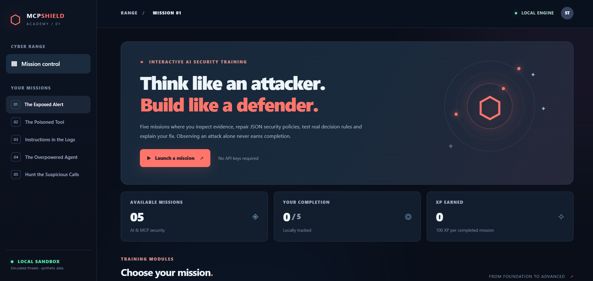
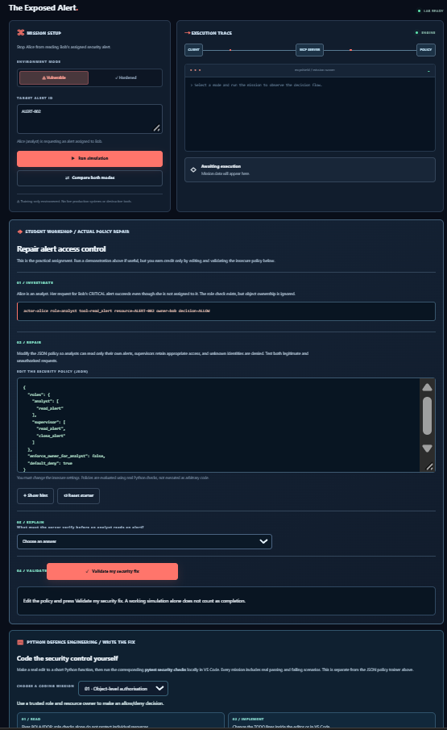
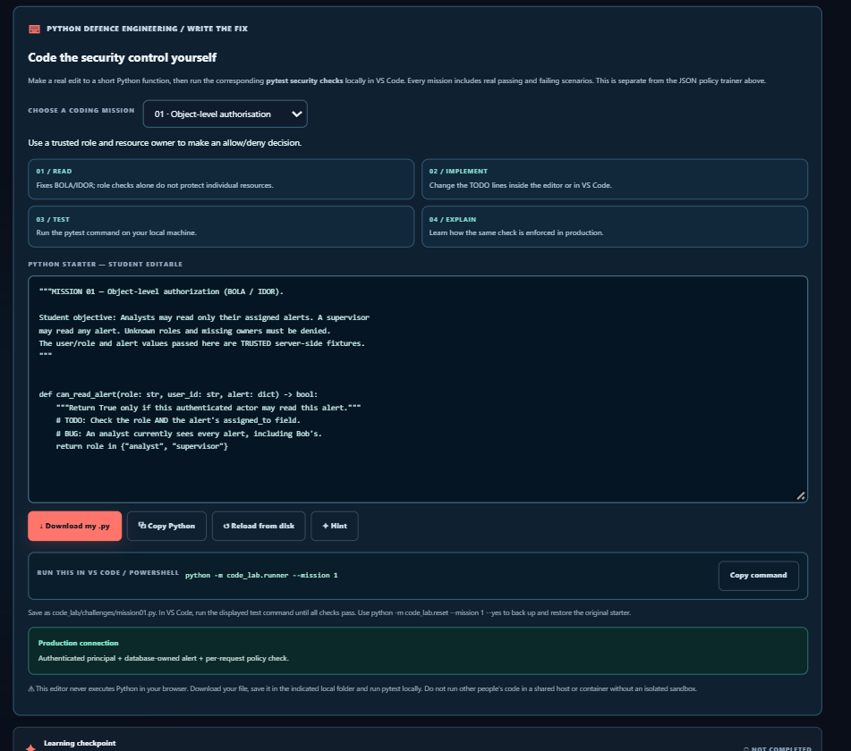
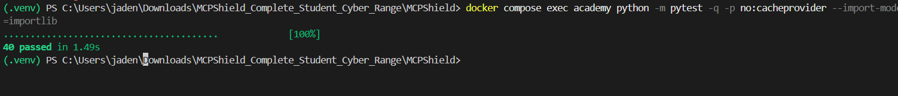
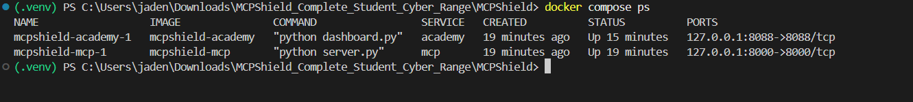

# MCPShield Academy

### Think like an attacker. Build like a defender.

**A hands-on cyber range for Model Context Protocol (MCP) and AI-agent security.** Explore how tool-connected agents can fail, investigate simulated attacks, write the missing security controls, and prove your fixes with automated tests.



<p>
  
  
  
  
  
</p>

> **The idea:** A security demo shows you what went wrong. MCPShield asks you to **fix it**. Each mission combines evidence, vulnerable-versus-hardened behaviour, an editable security policy, a knowledge check, and a separate Python coding challenge.

**[Get started](#quick-start)** · **[Explore the missions](#five-security-missions)** · **[Try the coding lab](#hands-on-python-defence-engineering)** · **[Architecture](#architecture)** · **[Documentation](#documentation)**

---

## What makes this different?

- **Attack → defend → verify.** Reproduce a controlled failure, identify the trust boundary, implement a rule, and test both allowed and denied behaviour.
- **Two practical learning tracks.** Repair structured JSON security policies in the browser, then implement corresponding defensive logic in editable Python files.
- **A real MCP endpoint.** A separate Python MCP server exposes security training tools via **Streamable HTTP**, which can be explored using MCP Inspector.
- **Deterministic, repeatable labs.** Synthetic alerts, tool metadata, attack strings and audit events mean no external accounts, API keys, paid models or live targets are required.
- **Containerised by default.** Two Docker services are bound to the host's loopback interface, with read-only filesystems, dropped capabilities and restricted privileges.

### At a glance

| | |
|---|---|
| **Audience** | Cybersecurity students, SOC analysts, AI-security learners and instructors |
| **Format** | Interactive browser range + local Python coding exercises |
| **Scope** | 5 missions covering access control, tool poisoning, prompt injection, least privilege and audit detection |
| **Stack** | Python, MCP Python SDK, HTML/CSS/JavaScript, pytest, Docker Compose |
| **Dashboard** | `http://127.0.0.1:8088` |
| **MCP endpoint** | `http://127.0.0.1:8000/mcp` |
| **Last locally verified application suite** | **40 passed**, 0 failed, inside Docker |

## Quick start

### Option A — Docker (recommended)

**Prerequisites:** Docker Desktop / Docker Engine with Linux containers and Docker Compose.

```bash
git clone https://github.com/jaden-mas1010/mcpshield-academy.git
cd mcpshield-academy
docker compose up --build -d
docker compose ps
```

Open **[http://127.0.0.1:8088](http://127.0.0.1:8088)** on the same computer and select a mission.

The stack starts two separate services:

| Service | Port | Purpose |
|---|---|---|
| `academy` | `127.0.0.1:8088` | Mission dashboard, attack walkthroughs and JSON-policy grading |
| `mcp` | `127.0.0.1:8000` | MCP tool server for protocol-level exploration |

**Verify the application:**

```bash
docker compose exec academy python -m pytest -q -p no:cacheprovider --import-mode=importlib
```

The main suite was verified with **40 passing tests**. The intentionally failing *student coding exercises* are separate from this application suite.

**Shut down:**

```bash
docker compose down
```

> The MCP URL is a protocol endpoint, **not** a normal web page. Use an MCP client such as [MCP Inspector](https://github.com/modelcontextprotocol/inspector) to connect using **Streamable HTTP**.

### Option B — Windows PowerShell (local Python)

**Prerequisite:** Python 3.11 or newer.

```powershell
git clone https://github.com/jaden-mas1010/mcpshield-academy.git
cd mcpshield-academy
py -3 -m venv .venv
.\.venv\Scripts\python.exe -m pip install -r requirements.txt
.\.venv\Scripts\python.exe dashboard.py
```

Open **http://127.0.0.1:8088**. To run the MCP server as well, open a **second PowerShell terminal** in the same directory:

```powershell
.\.venv\Scripts\python.exe server.py
```

Do not run these local servers at the same time as Docker's published ports; both modes use ports `8088` and `8000`.

## Five security missions

| Mission | Threat | Your defensive objective |
|---|---|---|
| **01 — The Exposed Alert** | Broken object-level authorisation (BOLA / IDOR) | Stop an analyst from reading another analyst's assigned alert while preserving legitimate access. |
| **02 — The Poisoned Tool** | Tampered MCP tool descriptions | Compare tool definitions against a trusted manifest and reject unknown or modified metadata. |
| **03 — Instructions in the Logs** | Indirect prompt injection | Treat tool-response content as untrusted data; never allow embedded instructions to authorise privileged actions. |
| **04 — The Overpowered Agent** | Excessive agency / tool permissions | Give an investigation agent only the specific tools it needs; block destructive or administrative actions. |
| **05 — Hunt the Suspicious Calls** | Abnormal MCP tool use | Detect privilege abuse, tool tampering and repeated access denials without flagging normal activity. |

Each mission follows the same cycle:

**Inspect evidence → Run the vulnerable demonstration → Compare the secure behaviour → Repair the JSON policy → Validate → Explain the fix.**

Clicking through an attack simulation **does not** earn completion; the browser workshop checks the student's proposed policy and understanding.



## Hands-on Python Defence Engineering

The browser workshop is an introduction. The **Python Defence Engineering** track asks learners to write the actual security decisions and run isolated, mission-specific tests.



**Try Mission 01:**

1. Open `code_lab/challenges/mission01.py` in VS Code.
2. Find the missing object-ownership check.
3. Run its tests and observe the failure on the intentionally vulnerable starter.
4. Edit `can_read_alert(...)` to apply both role permissions **and** record ownership.
5. Rerun the tests until legitimate reads work and unauthorised reads are denied.

On Windows, from the project root:

```powershell
.\.venv\Scripts\python.exe -m code_lab.runner --mission 1
```

Check all five coding missions:

```powershell
.\.venv\Scripts\python.exe -m code_lab.runner
```

Reset a mission to its starter version, saving a backup of your work:

```powershell
.\.venv\Scripts\python.exe -m code_lab.reset --mission 1 --yes
```

**Expected teaching behaviour:** On fresh, intentionally insecure Python starters, **8 of 23 tests pass and 15 fail**. Those failures are the exercises, not regressions in the application. The separately verified instructor reference implementations pass all 23 coding checks.

> The browser's Python editor is a **scratchpad**, not a code-execution service. Download or copy your edited code into `code_lab/challenges/`, then run tests locally. Browser-submitted Python is never executed by the Academy server.

See the [Coding Lab Guide](code_lab/README.md) and [Production Bridge](code_lab/PRODUCTION_BRIDGE.md) for the complete workflow and how these teaching controls differ from production engineering.

## Architecture


The system has **two distinct paths**:

**1. Interactive learning path** — Browser → `dashboard.py` → mission simulations / `student_lab.py` JSON-policy grader. The animated agent/tool traces illustrate security decisions; they do **not** represent live model reasoning or captured MCP traffic.

**2. MCP protocol path** — MCP Inspector → `server.py` → real MCP tools → synthetic alerts, security checks and simulated responses. The endpoint speaks MCP over Streamable HTTP, but its classroom identity (`LAB_ROLE`, `LAB_USER`) is configured server-wide rather than authenticated per request.

The **Python coding track** is separate from both: learners edit `code_lab/challenges/missionNN.py` on their own machines and run pytest. The web application never executes their submissions.

### Explore the actual MCP tools

With the `mcp` service running:

1. Open [MCP Inspector](https://github.com/modelcontextprotocol/inspector).
2. Connect via **Streamable HTTP** to `http://127.0.0.1:8000/mcp`.
3. List available tools and try `read_alert` or `investigate_security_logs`.
4. Compare tool results with the educational scenarios in the dashboard.

The MCP tools work against **synthetic records**; the prompt-injection demonstration is **deterministic, without an LLM**.

## Testing & evidence

| Test layer | What it checks | Expected result |
|---|---|---|
| Application suite (`tests/`) | Server functions, missions, dashboard routes, grading, resets and student-lab behaviour | **40 passed** on the verified Docker run |
| Coding exercises (`code_lab/tests/`) | Whether learners implemented actual defensive controls | Intentionally red on fresh starters: **8 pass / 15 fail** |
| Container status | Dashboard and MCP server can run together | Both services `Up` |
| Manual protocol check | MCP Inspector connects and lists/calls tools | Confirm separately using Inspector |

Application-suite evidence:



Container deployment evidence:



## Project structure

```text
mcpshield-academy/
├── dashboard/              # Browser interface, styles and animations
├── dashboard.py             # Local dashboard server and JSON APIs
├── server.py                # Streamable HTTP MCP tool server
├── missions/                # Five threat simulations and security decisions
├── student_lab.py           # JSON policy validation and grading
├── code_lab/
│   ├── challenges/         # Five editable Python exercises
│   ├── tests/              # Independent security checks for learners
│   ├── runner.py           # Per-mission and full-track test runner
│   └── reset.py            # Backup + reset utility
├── tests/                   # Application and reference test suite
├── docs/                    # Architecture, student, instructor and ops guides
├── screenshots/             # Dashboard, exercise and deployment evidence
├── compose.yaml             # Two localhost-bound Docker services
├── Dockerfile
└── requirements.txt
```

## Documentation

| Guide | What you'll find |
|---|---|
| [Student Guide](docs/STUDENT_GUIDE.md) | Learning objectives, mission workflow and reflection prompts |
| [Instructor Guide](docs/INSTRUCTOR_GUIDE.md) | Teaching plan and evaluation guidance |
| [Coding Lab](code_lab/README.md) | Editable exercises, tests and reset commands |
| [Production Bridge](code_lab/PRODUCTION_BRIDGE.md) | Where educational controls differ from deployable security |
| [Architecture](docs/architecture.md) | Components, data paths and trust boundaries |
| [Testing](docs/TESTING.md) | Test scope and expected results |
| [Operations](docs/OPERATIONS.md) | Setup, troubleshooting, resets and shutdown |
| [Demo Script](docs/DEMO_SCRIPT.md) | Guided three-minute walkthrough |

## Safety and limitations

MCPShield Academy is an **educational cyber range**, not a production MCP firewall, security scanner or autonomous agent platform.

- All identities, alerts, attacks and event logs are **synthetic**. No external targets or real organisational data are used.
- Services are published to **`127.0.0.1` only**. Do not expose deliberately vulnerable modes to public networks or deploy this demo as an internet-facing service.
- Browser demonstrations are scripted / deterministic. **There is no live LLM, real-world intrusion detection or production-grade identity system.**
- Python submitted through the browser is **not executed**; local coding tasks should be run only in an environment you control.
- Passing training tests demonstrates specific teaching objectives, **not production readiness**. Real services need verified identity, protected trust stores, tenant isolation, monitoring and end-to-end review.

## About this project

Built as an independent **Cyber Range Lab Development & Automation** internship assignment for **RedKross Research Foundation**, with a focus on connecting AI-agent threat concepts to **hands-on secure coding and verifiable defensive behaviour**.

**Author:** [Jaden Mascarenhas](https://github.com/jaden-mas1010) · [Portfolio](https://jaden-mas1010.github.io)

*Project publication and reuse remain subject to applicable internship and intellectual-property terms.*
