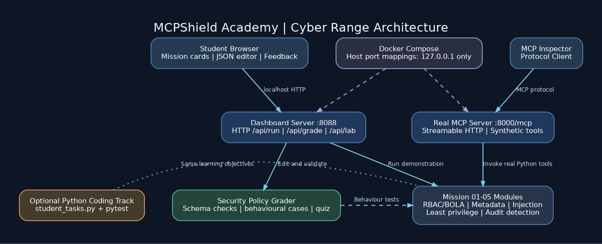

# Architecture

## Components

- **Student browser:** presents five mission cards, simulated tool traces, an editable JSON policy workshop, grading feedback and a knowledge check. The UI runs at `127.0.0.1:8088`.
- **Python dashboard server (`dashboard.py`):** serves static frontend files and two local JSON APIs: `/api/run` for demonstrations, `/api/grade` for meaningful policy evaluation, plus `/api/lab/<id>` and read-only `/api/coding/<id>` for mission metadata.
- **Mission modules:** five small Python modules implementing reference policies, attack simulation, tool-grant decisions and synthetic log detection.
- **JSON policy grader (`student_lab.py`):** validates each user-edited policy against a restricted schema and exercises realistic allow/deny behaviour; **does not evaluate arbitrary Python code submitted in the browser**.
- **MCP server (`server.py`):** separate actual MCP Streamable HTTP endpoint at `127.0.0.1:8000/mcp`; exposed tools call the mission modules, returning synthetic data only.
- **MCP Inspector:** optional real MCP client connected to the local endpoint.
- **Source-code practice:** The five `code_lab/challenges/missionNN.py` source files, `code_lab/tests/` checks, a local CLI runner and safe reset utility support real Python editing. The dashboard only **displays/downloads** source (never runs it). The original `student_tasks.py` is retained for compatibility. Do not execute other users' submitted Python on a shared server.

## Trust boundaries and controls

1. The frontend supplies JSON policy drafts but cannot instruct the backend to run Python source code.
2. Synthetic log messages and tool metadata are deliberately untrusted teaching inputs.
3. Policy checks take place in Python functions, not just visual toggles.
4. The MCP simulation uses server-wide role/user environment variables; this demonstrates principles but is not a substitute for authenticated identities.
5. Both Docker published ports bind to `127.0.0.1` on the host. Docker container processes bind to `0.0.0.0` internally to accept mapped traffic; they must never be deployed on public ports.
6. The dashboard's animated request-flow is illustrative; Mission 03 does not contact an LLM, Mission 05 processes static audit fixtures.
